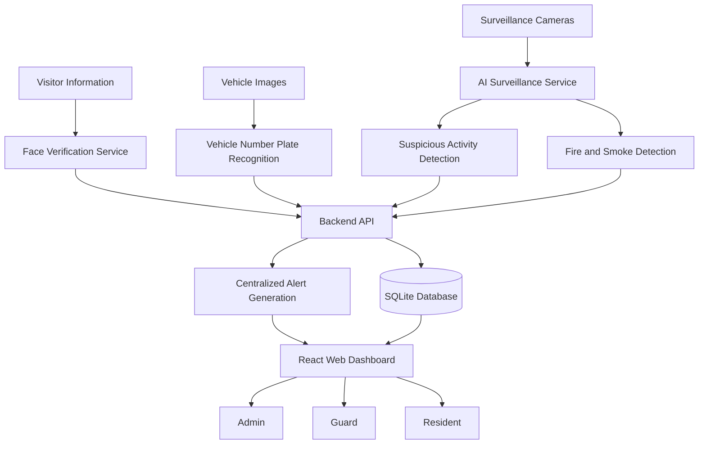

# RESIDE – AI Powered Smart Surveillance System

An AI-powered smart surveillance platform designed to enhance residential community security through intelligent activity monitoring, fire and smoke detection, face verification, and vehicle number plate recognition.

## Overview

RESIDE is an integrated smart surveillance system that automates security monitoring in residential communities. It combines computer vision, deep learning, and web technologies to identify potential security threats, verify visitors, recognize vehicles, and generate centralized alerts.

The system reduces dependency on continuous manual CCTV monitoring by providing automated detection, verification, and incident management through a centralized platform.

## Problem Statement

Traditional residential security systems rely heavily on manual CCTV monitoring and manual visitor and vehicle verification. This can lead to delayed incident detection, human errors, and inefficient security management.

RESIDE addresses these challenges through AI-powered surveillance, automated identity verification, vehicle recognition, and real-time alert generation.

## Key Features

### 1. Suspicious Activity Detection
- Detects potentially suspicious activities from surveillance footage.
- Uses deep learning-based video analysis.
- Supports detection of activities such as fighting, falling, running, loitering, snatching, and crowd formation.
- Generates security events for further monitoring.

### 2. Fire and Smoke Detection
- Uses a fine-tuned YOLOv8 model to identify fire and smoke.
- Processes surveillance footage for potential fire hazards.
- Generates alerts when fire or smoke is detected.

### 3. Face Registration and Verification
- Allows residents to register their facial information.
- Uses InsightFace and ArcFace-based facial embeddings.
- Enables guards to verify visitors through facial recognition.
- Supports verification against registered resident records.

### 4. Vehicle Number Plate Recognition
- Detects vehicle number plates using computer vision.
- Uses OpenCV for image processing and plate detection.
- Uses PaddleOCR for extracting vehicle registration numbers.
- Supports vehicle verification and visitor vehicle requests.

### 5. Centralized Alert Management
- Combines security events from different detection modules.
- Provides centralized monitoring of security incidents.
- Supports role-based access for residents, guards, administrators, and super administrators.

## Technology Stack

| Component | Technologies |
|---|---|
| Frontend | React, TypeScript |
| Backend | Python, FastAPI |
| Database | SQLite, SQLAlchemy |
| Authentication | JWT, Python-JOSE, Passlib |
| Activity Detection | Deep Learning, CNN-based video classification |
| Fire and Smoke Detection | YOLOv8 |
| Face Recognition | InsightFace, ArcFace |
| Vehicle Recognition | OpenCV, PaddleOCR |
| Computer Vision | OpenCV |
| API Communication | REST APIs |

## System Architecture

RESIDE consists of multiple interconnected modules that communicate through backend APIs.



## Methodology

### AI-Based Surveillance
1. Surveillance footage is provided to the AI service.
2. Video frames are processed for suspicious activities.
3. Fire and smoke detection is performed using YOLOv8.
4. Detected events are evaluated and converted into security alerts.
5. Alerts are made available through the centralized dashboard.

### Visitor and Vehicle Verification
1. Residents register their facial information.
2. When a visitor arrives, the guard initiates verification.
3. The system compares the visitor's face with registered facial information.
4. Vehicle images are processed to detect and extract number plates.
5. The extracted vehicle number is used for verification against vehicle records and requests.
6. Verification results are communicated through the backend.
7. Relevant security events and alerts are recorded.

## AI Models and Technologies

| Model / Technology | Purpose |
|---|---|
| YOLOv8 | Fire and smoke detection |
| InsightFace | Face detection and recognition |
| ArcFace | Facial feature representation and recognition |
| PaddleOCR | Vehicle number plate text extraction |
| OpenCV | Image processing and number plate detection |
| CNN-based Video Classification | Suspicious activity recognition |

## Project Structure

```text
RESIDE/
│
├── frontend/
│   └── React application
│
├── backend/
│   └── app/
│       ├── models/
│       ├── routes/
│       ├── schemas/
│       ├── services/
│       └── main application
│
├── ai_service/
│   └── AI surveillance and detection modules
│
├── face-service/
│   └── Face recognition service
│
├── _model_cache/
│   └── Model weights (excluded from GitHub)
│
├── requirements.txt
├── setup.bat
├── README.md
└── README_RUN.md
```

*The folder structure is a high-level representation of the project.*

## Installation and Setup

### Prerequisites

- Python 3.11
- Node.js and npm
- Git
- Required AI model weights
- Windows environment (for the provided setup script)

### 1. Clone the Repository

```bash
git clone https://github.com/SkandaShandilya/Reside.git
cd Reside
```

### 2. Backend Setup

Create and activate a Python virtual environment:

```bash
python -m venv venv
venv\Scripts\activate
```

Install dependencies:

```bash
pip install -r requirements.txt
```

Configure the required environment variables using the project's configuration and environment template.

### 3. Frontend Setup

```bash
cd frontend
npm install
```

Start the frontend:

```bash
npm run dev
```

### 4. AI Services Setup

Install the dependencies required by the AI services and face recognition service using their respective requirements files.

Ensure that the required model weights are downloaded and configured in the expected model directories.

### 5. Run the Application

Refer to `README_RUN.md` and `setup.bat` for the project's complete service startup sequence and configuration instructions.

## Security and Configuration

- Authentication is implemented using JWT.
- Access is controlled through role-based authorization.
- Environment-specific credentials must be configured separately.
- Sensitive environment files and local databases are excluded from version control.
- Production deployments should use secure JWT secrets and appropriate database configurations.

## Model Weights and Datasets

Large AI model weights, datasets, and local model-cache files are intentionally excluded from this repository to keep the repository lightweight.

They must be obtained separately and placed in their respective directories before running the corresponding AI services.

## Future Enhancements

- Cloud-based deployment and centralized storage.
- Improved detection accuracy under challenging surveillance conditions.
- Mobile application integration.
- Advanced analytics and security incident reporting.
- Integration with IoT-based security devices.
- Scalable multi-camera monitoring.

## Applications

- Residential apartments and gated communities.
- Commercial buildings and office campuses.
- Educational institutions.
- Industrial facilities.
- Public spaces and parking facilities.

## Project Information

**Project Name:** RESIDE – AI Powered Smart Surveillance System

**Domain:** Artificial Intelligence, Machine Learning and Computer Vision

**Repository:** [GitHub – RESIDE](https://github.com/SkandaShandilya/Reside)

---

*RESIDE aims to make residential security smarter, faster, and more reliable through the integration of artificial intelligence and automated surveillance.*
